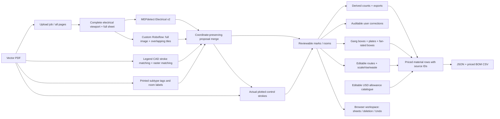

# Atreyus — AI Electrical Takeoff

Live application: **https://atreyus.mobilemonero.com**

A review-first electrical takeoff workspace for the four City of Escondido PAADU
assessment sheets. Every quantity derives from a positioned component. Select a
type or room in the takeoff table to isolate the corresponding marks.

## Run locally

Requirements: Python 3.11+, Node 22.12+ (Vite 8), network access to the inference
providers. No GPU or generic YOLO weights are required by the active API.

```powershell
cd atreyus
py -m pip install -r backend_ai/requirements-api.txt
npm ci
```

Run these in separate terminals:

```powershell
cd backend_ai
py -m uvicorn main:app --host 0.0.0.0 --port 8000
```

```powershell
npm run dev -- --port 5175
```

Open http://localhost:5175 for development. Vite proxies `/api` and `/results` to the Python API.

For the stable hosted walkthrough, run `npm run build`, then `start.ps1`. The script
starts the API and serves the **compiled `dist` frontend** when their ports are
free (and builds it if absent). Its fixed-build server has no development hot
reload, so generated job/export artifacts do not reset the selected sheet. This
hosted build listens on http://localhost:5174, behind the existing public tunnel.
Restart the API after Python edits. Rebuild the frontend after UI changes; use
`npm run dev` in a development terminal when actively editing the UI.

### Credentials

The API reads `../relay/.env` relative to this project's root. Override the path
with `ATREYUS_ENV_FILE`, or set environment variables directly:

- `MEPDETECT_API_KEY`
- `MEPDETECT_MODEL_ID` (optional; default `0291b928`, Electrical v2)
- `ROBOFLOW_API_KEY`
- `ROBOFLOW_MODEL_ID` (the custom deployed model identifier)

Credentials stay server-side. Do not commit the environment file. Health reports
configuration booleans, never credentials. Both providers can incur inference costs.

## Workflow

1. Select a supplied home, or **Upload PDF**. A background job renders **every
   page** independently. Progress is polled; remote inference is not part of upload.
2. Select **Run detection** on a sheet. Hybrid uses MEPdetect and custom Roboflow,
   with vector/raster legend refinement for the supplied plan style.
3. Inspect marks, optional bounding boxes, and room boundaries. **Full sheet &
   legend** opens the original page context. The supplied third-party crops cut
   off parts of several homes; this app renders complete viewports from the PDF.
4. Add a component, click to edit its type/room, drag to move, or delete it. Draw a
   room to assign its enclosed marks. Undo restores previous changes.
5. Filter the table by room/type. JSON includes every mark, room, provenance and
   correction record; CSV contains the room-by-type count schedule.
6. Turn on **Locations** to see gang-sized switch boxes, device boxes, and fan-rated
   boxes. Moving a switch changes its grouping. Click a box label to change spare
   gang capacity or inspect its member devices. A switch can be placed in a
   separate box using its inspector.
7. Turn on **Cable** to see the traced control curves. Click a run to change cable
   type, endpoint links, inclusion or review status. Drag square handles to reshape
   the route. **Trace cable** creates a manual polyline; **Finish cable** saves it.
8. Open **Priced materials**. Edit unit prices, drawing scale, rise/drop and waste.
   Click any material row to highlight every object behind its quantity. Export
   the priced BOM CSV or full JSON, including source object IDs and assumptions.

### Delete old sheets and duplicate imports

Use the **trash icon on a sheet row** to remove that sheet and its saved takeoff.
For an old four-sheet set, choose **Manage sheets**, check its rows and choose
**Delete selected**. Upload/saved timestamps distinguish repeated imports. Deletion
persists after reload; **Undo sheet deletion** restores the last removal until
reload. Example sheets can be removed too, then returned with **Restore example
sheets**. **Clear** empties a takeoff but keeps its sheet in the list.

The workspace is browser-local: deletion removes its local marks, rooms, routes and
estimate settings. Source PDFs/images and inference caches are retained separately
on the API host. Deletion is disabled during processing, and workspace changes
synchronize across tabs. Each new upload remains a distinct set until removed.

Work is autosaved in this browser, not in a shared account. Export a portable copy
before changing browsers. Uploaded PDFs/images and inference caches are stored on
the API host in `backend_ai/uploads` and `backend_ai/results/v3`. Those directories
must persist across server restarts. Interrupted jobs report a retryable failure.

## What the detector actually does



- MEPdetect is a hosted pretrained YOLO detector. Its asynchronous job is polled
  and its **per-detection coordinates**, not summary counts, are downloaded.
- Roboflow is the configured custom model. Full-image and overlapping tile
  results are transformed back to the input image's coordinate system.
- Repeated CAD stroke sequences distinguish switches and fan glyphs from text,
  furniture and door arcs. Raster legend matching supplements incomplete vector
  matches. Each mark records whether it came from a model, vector glyph, or raster
  template; similarity scores are not calibrated AI probabilities.
- Printed tags refine `3D`, `D`, `F`, `VS`, `A`, `AFI`, `GFI`, `WP`, `240V`,
  `SD/MA`, and `IAQ`. Combined smoke/CO and WP/240V types count once.
- Supplied-sheet room rectangles are **human-traced layout metadata**, visible
  and editable. Device locations and quantities are never stored in those
  rectangles. Other PDFs use provisional nearest-text-label room assignment.
- Cache keys include image bytes, engine, and pipeline code fingerprint. Model
  proposals are also cached independently for reproducible local refinement.
- Cable tracing joins the PDF's actual tessellated dash strokes, including
  mirrored/reversed paths and zero-length CAD artifacts. Endpoint tags help locate
  control connections. Raw source-stroke indices and observed points are retained;
  editable curve vertices are simplified within 0.3 PDF points.
- Switch locations group adjacent aligned symbols into one box and matching
  plate. These are derived objects, so moving or deleting devices updates them.

## Accuracy and scope

This is a **draft takeoff requiring review**, not an independently certified quote.
The original custom Roboflow whole-image probe found only two lights; the initial
tile-only probe found none. Its configured availability does not establish useful
recall. MEPdetect also confuses some switches and fixtures with receptacles, which
is why legend geometry and text refinement are important. Open-plan boundaries,
attic/service fixtures, and densely labelled devices deserve particular attention.

The evaluation-only source audit in `benchmarks/annotations.py` contains **304
visually annotated electrical symbols**. Current supplied-sheet outputs match all
reference locations, types and rooms (56 / 67 / 83 / 98), with no extras, under a
6-PDF-point matching tolerance. This is an **agent-assisted in-sample audit**, not
independent estimator certification or evidence of accuracy on unseen plan styles.
The detector never reads the annotation file. See `benchmarks/README.md` and
`dogfood-evidence/accuracy-audit.json` for the methodology and per-class results.

Fan marks represent the drawing's **optional/prewire fan symbol**. The BOM includes
its fan-rated box but excludes optional fan supply unless explicitly enabled.

### Cable and pricing assumptions

- The supplied sheets use **1/4 inch = 1 foot**, or 18 PDF points per real foot.
  Other sheets need a user-confirmed scale before cable quantities are priced.
- Horizontal length follows the drawn curve as a routing proxy. Defaults add
  **4 ft per switch endpoint**, **10% waste**, and round each run up to a whole foot.
- Lighting controls use a **14/2 NM-B cost allowance**; motor/receptacle controls
  use **12/2**. Traced paths between 3-way controls use **14/3**. Note 6 specifies
  minimum 14 AWG at lighting and 12 AWG at other circuits. NM-B assembly prices are
  a cost proxy; the notes name TW/THW copper, so the installation method still needs
  confirmation. Change defaults or override any run. Parallel fan-control lines are
  priced as separate shown control connections unless the estimator combines or
  excludes them for a specified shared cable.
- Only shown control connections and manually drawn routes are priced. Undrawn
  feeds/receptacle circuits, labor and tax are excluded. Short or ambiguous routes
  still require review against the source drawing.
- Prices come from the **editable illustrative estimator allowance catalogue** in
  `src/takeoff/materials.mjs`, dated 28 October 2026, in USD. They are not supplier
  quotes. The panel is a generic allowance (note 5 calls for a 100 A subpanel and
  B32 references cover-sheet options); AFI-protected receptacles
  are priced as standard duplex devices, not a claim about breaker procurement.
- Recessed fixtures and exhaust/IAQ fans include their integral enclosure allowance;
  wall/service fixtures and detectors receive separate round boxes. Review these
  assembly assumptions against the chosen products before a bid.
- Missing prices, orphaned included routes, and unconfirmed scale are reported as
  partial estimates. No quantity is invented to fill them.

## Verification

```powershell
npm run build
py scripts/verify_pipeline.py
node scripts/verify_ui.mjs
node scripts/verify_extensions.mjs
node scripts/verify_sheet_deletion.mjs
node --test scripts/materials.test.mjs
node --test scripts/workspace.test.mjs
py scripts/evaluate_accuracy.py
py -m unittest discover -s backend_ai/tests
```

The browser script requires Playwright (`npm install --no-save playwright` and
`npx playwright install chromium` if unavailable). It starts with a fresh browser
context, uses the public website's real forms, checks CRUD/undo/export/reload,
uploads the four-sheet PDF and checks each sheet's real image and positioned marks.
It writes `dogfood-evidence/ui-verification.json` and screenshots. The API script
tests the running server on port 8000; override with `ATREYUS_TEST_URL`.

See [DESIGN.md](DESIGN.md) for release/support decisions and
[VERIFICATION.md](VERIFICATION.md) for the latest measured results.
See [ESTIMATING.md](ESTIMATING.md) for cable, box, assembly and pricing assumptions.
See [WALKTHROUGH.md](WALKTHROUGH.md) for the assessment-aligned end-to-end review/demo
sequence, including cleanup of old sheet sets.

## Source layout

- `backend_ai/main.py`: active API, jobs, cache and fusion
- `backend_ai/providers.py`: MEPdetect / Roboflow adapters
- `backend_ai/plans.py`: PDF rendering and explicit coordinate metadata
- `backend_ai/vector_symbols.py`, `legend.py`: legend-conditioned proposals
- `backend_ai/room_regions.py`: reviewable supplied-plan room boundaries
- `backend_ai/plan_semantics.py`: keyed panel geometry and physical switch locations
- `backend_ai/wiring.py`: source-stroke control-curve tracing
- `src/components`: workspace, canvas, inspector and count table
- `src/takeoff`: coordinate mapping, persistence, counts and job client
- `src/takeoff/materials.mjs`: derived boxes, cable measurements and priced rows
- `benchmarks/`: evaluation-only source annotations and audit methodology
- `backend_ai/legacy_main.py`: retired implementation retained for comparison
- Other YOLOplan files retain their upstream license and are not the active API.
